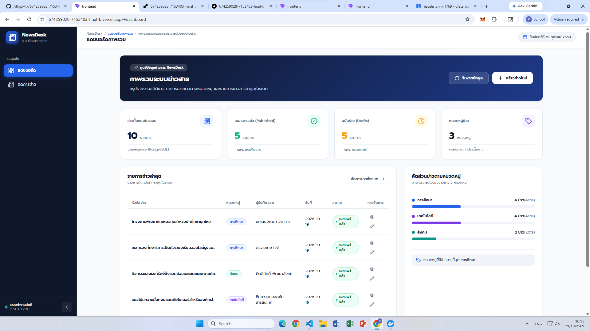
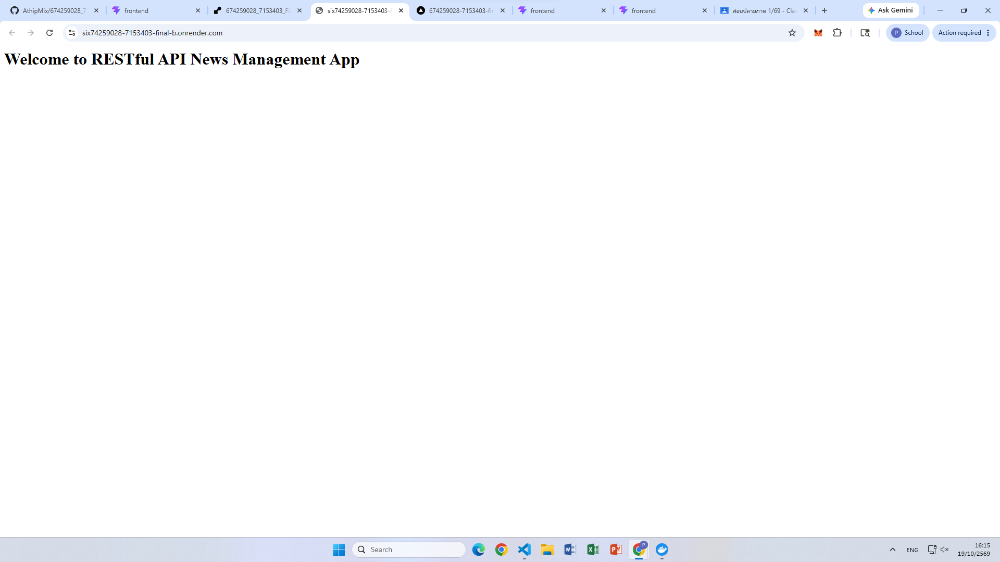

# 📰 NewsDesk - ระบบจัดการข่าวสาร (News Management System)

เว็บแอปพลิเคชันระบบจัดการข่าวสารแบบ Full-Stack ที่พัฒนาขึ้นตามข้อกำหนดการทดสอบ (Final Test) เพื่อบริหารจัดการข้อมูลข่าวสารอย่างเป็นระบบ รองรับการแสดงผล Dashboard ภาพรวม, การค้นหาและกรองข้อมูลแบบ Real-time ผ่าน Backend Query Parameters, การเพิ่ม-แก้ไข-ลบข้อมูลด้วยฟอร์มที่มีระบบ Validation, และการออกแบบ UI/UX ระดับ Modern Dashboard ที่รองรับการใช้งานบนทุกอุปกรณ์ (Responsive Web Design)

---

## 🌐 ลิงก์สำหรับเข้าใช้งานระบบบน Production (Live Production URLs)

| บริการ (Service) | URL สำหรับเข้าชม / ทดสอบ | รายละเอียด |
|---|---|---|
| **Frontend (Vercel)** | [https://674259028-7153403-final-b.vercel.app/](https://674259028-7153403-final-b.vercel.app/) | เว็บแอปพลิเคชันส่วนหน้า (Dashboard & ข่าวสาร) |
| **Backend API (Render)** | [https://six74259028-7153403-final-b.onrender.com](https://six74259028-7153403-final-b.onrender.com) | เซิร์ฟเวอร์ RESTful API ประมวลผลและเชื่อมต่อ DB |

---

### 📡 Endpoint ตัวอย่างที่เปิดทดสอบได้จริงบน Production (Live API Endpoints)

สามารถคลิกเปิดทดสอบผ่านเว็บเบราว์เซอร์หรือเครื่องมือยิง API (เช่น Postman, Thunder Client) ได้โดยตรง:

1. **ตรวจสอบสถานะเซิร์ฟเวอร์ (Health Check):**
   * URL: [`https://six74259028-7153403-final-b.onrender.com/`](https://six74259028-7153403-final-b.onrender.com/)
   * Response: ข้อความต้อนรับของระบบ RESTful API News Management App
2. **ดึงรายการข่าวสารทั้งหมด (GET All News):**
   * URL: [`https://six74259028-7153403-final-b.onrender.com/api/news`](https://six74259028-7153403-final-b.onrender.com/api/news)
   * Response: JSON Array ของข่าวสารทั้งหมดในฐานข้อมูล เรียงตามวันที่ล่าสุด
3. **ทดสอบการค้นหาด้วยคำค้นบางส่วน (Search by Keyword):**
   * URL: [`https://six74259028-7153403-final-b.onrender.com/api/news?search=เทคโนโลยี`](https://six74259028-7153403-final-b.onrender.com/api/news?search=เทคโนโลยี)
   * Response: รายการข่าวสารที่มีคำว่า "เทคโนโลยี" ในหัวข้อ, ผู้รับผิดชอบ หรือเนื้อหา
4. **ทดสอบการกรองตามหมวดหมู่ (Filter by Category):**
   * URL: [`https://six74259028-7153403-final-b.onrender.com/api/news?category=การศึกษา`](https://six74259028-7153403-final-b.onrender.com/api/news?category=การศึกษา)
   * Response: รายการข่าวสารเฉพาะหมวดหมู่ "การศึกษา"
5. **ทดสอบการค้นหาและกรองร่วมกัน (Search + Category Filter):**
   * URL: [`https://six74259028-7153403-final-b.onrender.com/api/news?search=วิจัย&category=การศึกษา`](https://six74259028-7153403-final-b.onrender.com/api/news?search=วิจัย&category=การศึกษา)
   * Response: ข่าวสารหมวดหมู่การศึกษาที่มีคำค้นว่า "วิจัย"
6. **ดึงรายละเอียดข่าวตามรหัส (GET News by ID):**
   * URL: [`https://six74259028-7153403-final-b.onrender.com/api/news/1`](https://six74259028-7153403-final-b.onrender.com/api/news/1)
   * Response: ข้อมูลข่าวสารรหัสที่ 1 แบบครบทุกฟิลด์

---

## 📸 ภาพสถานะการ Deploy และการทำงานของระบบ (Deployment & Demonstration)

### 1. สถานะ Deploy สำเร็จบน Vercel (Frontend)
แสดงสถานะ Deployment: **Ready** (Production) บนแดชบอร์ดของ Vercel พร้อมโดเมน `674259028-7153403-final-b.vercel.app`



---

### 2. สถานะ Deploy สำเร็จบน Render (Backend API)
แสดงสถานะ Web Service: **Live** บน Render Dashboard พร้อมเชื่อมต่อฐานข้อมูล PostgreSQL ผ่าน Environment Variable



---

### 3. ภาพสาธิตการทำ CRUD & ค้นหา-กรองข้อมูลผ่าน URL จริงบน Production
ภาพแสดงขั้นตอนการใช้งานจริงบนเว็บไซต์โปรดักชัน:
* **Create:** การเปิด Modal ฟอร์มเพิ่มข่าวสารใหม่พร้อม Validation
* **Read & Detail:** การแสดงผลตาราง การจัดหมวดหมู่ และการกดดูรายละเอียดครบทุกฟิลด์
* **Search & Filter:** การพิมพ์ค้นหาคำค้นบางส่วนและการเลือกหมวดหมู่ที่ส่งไปประมวลผลที่ Backend
* **Update:** การเลือกรายการข่าว ดึงข้อมูลเดิมมาแก้ไขและบันทึกผลสำเร็จ
* **Delete:** การแสดง SweetAlert2 ยืนยันการลบข่าวสารอย่างปลอดภัย


*(หากยังไม่ได้บันทึกไฟล์ภาพ สามารถบันทึกภาพหน้าจอมาวางที่โฟลเดอร์ `docs/screenshots/` ในโปรเจกต์ได้ทันที)*

---

## 📋 1. ชุดโจทย์และข้อกำหนดของระบบ

### 1.1 การแสดงข้อมูลข่าว (Read & Details)
* แสดงข้อมูลข่าวสารจากฐานข้อมูลในรูปแบบตารางและรายการ ประกอบด้วย 6 ฟิลด์หลัก: **รหัส (id)**, **ชื่อ/หัวข้อ (title)**, **ผู้รับผิดชอบ/ผู้รายงาน (operations)**, **หมวดหมู่ (category)**, **วันที่เผยแพร่ (date)**, และ **สถานะ (status)**
* สามารถคลิกเปิดดูรายละเอียดครบทุกฟิลด์ของรายการที่เลือกได้ผ่านหน้าต่าง Modal
* มีสถานะกำลังโหลดข้อมูล (Loading Shimmer Skeleton) เมื่อระบบกำลังเรียกข้อมูลจาก API
* แสดงข้อความและภาพสถานะว่าง (Empty State) เมื่อยังไม่มีข้อมูลในระบบ หรือค้นหาไม่พบข้อมูล
* แสดงข้อความแจ้งเตือนเมื่อการเรียก API ไม่สำเร็จ (Error Alert Box)

### 1.2 การเพิ่มข้อมูลข่าว (Create)
* มีแบบฟอร์มบันทึกข้อมูลครบทุกฟิลด์ที่กำหนด พร้อมแสดงเครื่องหมาย `*` ในช่องที่จำเป็น
* มีช่องเลือกหมวดหมู่ (Dropdown เลือก: `การศึกษา`, `เทคโนโลยี`, `สังคม`)
* มีช่องเลือกวันที่ (HTML5 Date Input รองรับการเลือกปฏิทิน)
* มีช่องเลือกสถานะ (Dropdown เลือก: `ฉบับร่าง (Draft)` หรือ `เผยแพร่แล้ว (Published)`)
* รองรับการกรอกรายละเอียดเนื้อหาข่าวเพิ่มเติม (`description`)
* มีระบบตรวจสอบความถูกต้องของข้อมูล (Validation) ก่อนส่งไปยัง API หากกรอกไม่ครบจะแสดงข้อความเตือนสีแดงใกล้ช่องกรอก
* แสดงปุ่มบันทึกพร้อมสถานะ Loading ป้องกันการกดส่งซ้ำ
* เมื่อเพิ่มสำเร็จ ระบบจะรีเซ็ตฟอร์ม โหลดข้อมูลล่าสุดมาแสดงผล และแจ้งผลสำเร็จด้วย SweetAlert2

### 1.3 การแก้ไขข้อมูลข่าว (Update)
* เลือกรายการข่าวแล้วดึงข้อมูลเดิมมาแสดงในแบบฟอร์มแก้ไขโดยอัตโนมัติ (Pre-fill Data)
* บันทึกการแก้ไขผ่าน API (HTTP Method `PUT`) และปรับปรุงรายการล่าสุดบนหน้าเว็บทันที
* มีปุ่ม "ยกเลิก" สำหรับยกเลิกการแก้ไข โดยไม่เปลี่ยนแปลงข้อมูลในฐานข้อมูล

### 1.4 การลบข้อมูลข่าว (Delete)
* แสดงหน้าต่างยืนยันการลบ (SweetAlert2) พร้อมระบุ **ชื่อหัวข้อข่าว** ที่ต้องการลบอย่างชัดเจน
* หากกดยกเลิก จะไม่มีการส่งคำขอลบไปยัง API และคงข้อมูลเดิมไว้ในระบบ
* หากกดยืนยัน จะดำเนินการลบผ่าน API (HTTP Method `DELETE`) และปรับปรุงรายการบนหน้าเว็บทันที

### 1.5 การค้นหาและกรองข้อมูลข่าว (Search & Filter)
* ค้นหาจากชื่อหรือหัวข้อข่าวด้วยคำค้นบางส่วน (Partial Match)
* กรองข้อมูลตามหมวดหมู่ได้ (`การศึกษา`, `เทคโนโลยี`, `สังคม`)
* สามารถใช้งานคำค้นหาและตัวกรองหมวดหมู่ร่วมกันได้ โดยประมวลผลที่ฝั่ง **Backend ผ่าน Query Parameters** (`/api/news?search=...&category=...`)
* มีปุ่ม "ล้างตัวกรอง" เพื่อคืนค่าเงื่อนไขทั้งหมดและกลับมาแสดงรายการข่าวสารทั้งหมด

### 1.6 ข้อกำหนดด้านการพัฒนา (Development Standards)
* **Frontend:** ใช้ React Hooks (`useState`, `useEffect`, `useCallback`) จัดการข้อมูลและสถานะหน้าจอ แยกโฟลเดอร์ตามหน้าที่:
  * `src/components/` เก็บชิ้นส่วน UI ที่ใช้ซ้ำ (Sidebar, Topbar, NewsTable, NewsForm, NewsDetail)
  * `src/pages/` เก็บหน้าจอหลัก (`DashboardPage.jsx`, `NewsPage.jsx`)
  * `src/services/` เก็บโค้ดเรียก API (`newsService.js`)
  * `src/constants/` เก็บค่าคงที่ของระบบ (`newsConstants.js`)
  * `.env` กำหนด URL ของ Backend ด้วย `VITE_API_URL`
* **Backend:** แยกสถาปัตยกรรมชัดเจนตามหน้าที่:
  * `router/` กำหนดเส้นทาง API Endpoints
  * `controller/` จัดการ Logic, Validation และ Query Parameters
  * `model/` กำหนด Schema ของตาราง
  * `config/` ตั้งค่าการเชื่อมต่อฐานข้อมูล
* **CORS & Environment:** ตั้งค่า CORS ให้ Frontend ติดต่อ Backend ได้ และใช้ `.env` สำหรับจัดการตัวแปรสภาพแวดล้อม
* **ความคงอยู่ของข้อมูล (Data Persistence):** ข้อมูลถูกบันทึกลงฐานข้อมูลจริง ไม่สูญหายเมื่อรีเฟรชหน้าเว็บหรือเริ่ม Backend ใหม่
* **ชุดข้อมูลทดสอบ:** มีข้อมูลในฐานข้อมูลจริงอย่างน้อย 10 รายการ ครบทั้ง 3 หมวดหมู่ และมีทั้งสถานะเผยแพร่แล้วกับฉบับร่าง

---

## 🛠️ 2. เครื่องมือและเทคโนโลยีที่ใช้ (Tech Stack)

| ส่วนงาน | เทคโนโลยี / เครื่องมือ | เวอร์ชัน / รายละเอียด |
|---|---|---|
| **Frontend Framework** | React 19 + Vite 8 | Single Page Application (SPA) ความเร็วสูง |
| **Hosting (Frontend)** | Vercel | Cloud Edge Deployment สำหรับเว็บแอปพลิเคชัน |
| **Hosting (Backend)** | Render | Cloud Web Service สำหรับ Node.js / Express |
| **Icons Library** | `lucide-react` | ชุดไอคอน UI โมเดิร์นสำหรับ Dashboard และปุ่มคำสั่ง |
| **Alerts & Modals** | `sweetalert2` | หน้าต่างป๊อปอัปแจ้งเตือนและยืนยันการลบข้อมูล |
| **Design System** | Modern Custom CSS | ธีมสีกรมท่า-น้ำเงิน-ขาว-เทาอ่อน, Responsive Breakpoints |
| **Typography** | Google Fonts `Prompt` | ฟอนต์ภาษาไทยมาตรฐานที่อ่านง่ายและเป็นทางการ |
| **Backend Framework** | Node.js v22+ / Express.js | RESTful API (ES Module syntax) |
| **Database ORM** | Sequelize v6 | จัดการโมเดลและการเชื่อมต่อ PostgreSQL |
| **Database Driver** | `pg`, `pg-hstore` | PostgreSQL Client สำหรับ Node.js |
| **Database** | PostgreSQL 12 Alpine / Cloud Postgres | ฐานข้อมูลเชิงสัมพันธ์ (Relational Database) |
| **Containerization** | Docker & Docker Compose | จำลองสภาพแวดล้อม Multi-container สำหรับรันในเครื่อง |
| **Environment Config** | `dotenv` | จัดการค่าความลับและพอร์ตของระบบผ่าน `.env` |

---

## 📁 3. โครงสร้างไฟล์ในโปรเจกต์ (Project Structure)

```text
Final-Test-Product/
├── .env                      # Environment Variables ส่วนกลางสำหรับ Docker Compose
├── docker-compose.yml        # กำหนดคอนฟิก Multi-container (DB, Backend, Frontend)
├── README.md                 # คู่มือการติดตั้งและคำอธิบายชุดโจทย์ (ไฟล์นี้)
│
├── docs/                     # เอกสารและไฟล์มีเดียประกอบการนำเสนอ
│   └── screenshots/          # บันทึกภาพสถานะการ Deploy และการใช้งาน
│       ├── vercel-deploy.png
│       ├── render-deploy.png
│       └── crud-demo.gif
│
├── backend/                  # เซิร์ฟเวอร์ RESTful API (Node.js + Express)
│   ├── config/
│   │   └── database.js       # การตั้งค่าเชื่อมต่อ PostgreSQL ด้วย Sequelize (รองรับ DATABASE_URL)
│   ├── controller/
│   │   └── newsController.js # Logic การทำงาน CRUD, Search และ Category Filter
│   ├── model/
│   │   └── newsModel.js      # Sequelize Model ตาราง News
│   ├── router/
│   │   └── newsRouter.js     # กำหนดเส้นทาง Endpoint ของ /api/news
│   ├── .env                  # Environment Variables สำหรับ Backend
│   ├── index.js              # Entrypoint เริ่มต้นเซิร์ฟเวอร์ Express
│   └── package.json
│
└── frontend/                 # เว็บแอปพลิเคชันส่วนหน้า (React 19 + Vite)
    ├── src/
    │   ├── components/
    │   │   ├── Sidebar.jsx   # แถบเมนูด้านข้าง (ย่อ/ขยายได้ + Mobile Drawer)
    │   │   ├── Topbar.jsx    # แถบด้านบน (Breadcrumb + วันที่ไทย + ปุ่มคำสั่ง)
    │   │   ├── NewsTable.jsx # ตารางข่าว (Badges, Truncate, Skeleton, Actions)
    │   │   ├── NewsForm.jsx  # ฟอร์ม Modal เพิ่ม/แก้ไข (2 คอลัมน์, Validation)
    │   │   └── NewsDetail.jsx# Modal แสดงรายละเอียดข่าวครบทุกฟิลด์
    │   ├── constants/
    │   │   └── newsConstants.js # ค่าคงที่หมวดหมู่และชุดสี Badge ประจำหมวด
    │   ├── pages/
    │   │   ├── DashboardPage.jsx # หน้า Dashboard สรุปสถิติและสัดส่วนข่าว
    │   │   └── NewsPage.jsx      # หน้าจอหลักสำหรับบริหารจัดการข่าว
    │   ├── services/
    │   │   └── newsService.js    # ฟังก์ชันเรียก RESTful API ทั้งหมด
    │   ├── App.jsx           # โครงสร้าง Layout รวมและการสลับหน้า
    │   ├── index.css         # Modern Navy Design System & Responsive CSS
    │   └── main.jsx          # จุดเริ่มต้นการ Render ของ React
    ├── .env                  # กำหนด VITE_API_URL
    ├── vercel.json           # การตั้งค่า SPA Routing สำหรับ Vercel
    ├── package.json
    └── vite.config.js
```

---

## 🗄️ 4. การออกแบบและสร้างฐานข้อมูล (Database Design)

ระบบใช้ฐานข้อมูล **PostgreSQL** โดยมีชื่อฐานข้อมูลว่า **`news_db`** (หรือผ่าน `DATABASE_URL` เมื่อใช้งานบน Cloud)

### 4.1 ตารางข่าว (`news`)
ตาราง `news` ถูกนิยามผ่าน Sequelize Model (`backend/model/newsModel.js`) ประกอบด้วยฟิลด์ดังต่อไปนี้:

| ฟิลด์ (Field) | ชนิดข้อมูล (Data Type) | ข้อกำหนด (Constraints) | รายละเอียด |
|---|---|:---:|---|
| `id` | `INTEGER` | Primary Key, Auto Increment | รหัสข่าวสารประจำแถว |
| `title` | `VARCHAR(150)` | NOT NULL | หัวข้อข่าว |
| `operations` | `VARCHAR(100)` | NOT NULL | ผู้รับผิดชอบ หรือ ผู้รายงานข่าว |
| `category` | `VARCHAR(50)` | NOT NULL | หมวดหมู่ข่าว (`การศึกษา`, `เทคโนโลยี`, `สังคม`) |
| `date` | `DATEONLY` | NOT NULL | วันที่เผยแพร่ข่าว (`YYYY-MM-DD`) |
| `status` | `BOOLEAN` | NOT NULL, Default: `false` | สถานะ (`true` = เผยแพร่แล้ว, `false` = ฉบับร่าง) |
| `description` | `TEXT` | NULL (ไม่บังคับ) | รายละเอียดเนื้อหาข่าว |
| `createdAt` | `TIMESTAMPTZ` | NOT NULL | วันที่และเวลาที่บันทึกข้อมูลเข้าระบบ |
| `updatedAt` | `TIMESTAMPTZ` | NOT NULL | วันที่และเวลาที่มีการปรับปรุงข้อมูลล่าสุด |

---

### 4.2 วิธีการสร้างฐานข้อมูล

#### วิธีที่ 1: สร้างอัตโนมัติด้วย Docker Compose (สำหรับการรันในเครื่อง)
```bash
docker compose up -d postgres-db
```

#### วิธีที่ 2: สร้างด้วย PostgreSQL โดยตรง (Local Installation)
```sql
CREATE DATABASE news_db;
```

---

### 4.3 ชุดข้อมูลเริ่มต้นสำหรับทดสอบ (Seed Data 11 รายการ ครบ 3 หมวดหมู่)

สามารถนำคำสั่ง SQL ด้านล่างนี้ไปรันในฐานข้อมูลเพื่อเตรียมข้อมูลให้ตรงตามข้อกำหนดข้อ 5:

```sql
INSERT INTO "News" ("title", "operations", "category", "date", "status", "description", "createdAt", "updatedAt") VALUES
('กระทรวงศึกษาธิการเปิดตัวระบบเรียนออนไลน์รูปแบบใหม่', 'ดร.สมชาย ใจดี', 'การศึกษา', '2026-10-01', true, 'ระบบเรียนออนไลน์รูปแบบใหม่ที่เน้นการเรียนรู้แบบโต้ตอบและการทำงานร่วมกัน', NOW(), NOW()),
('โครงการพัฒนาทักษะดิจิทัลสำหรับนักศึกษายุคใหม่', 'ผศ.ดร.วิภาดา วิชาการ', 'การศึกษา', '2026-10-05', true, 'เสริมสร้างทักษะการเขียนโปรแกรมและการวิเคราะห์ข้อมูลสำหรับนักศึกษา', NOW(), NOW()),
('ร่างหลักสูตรการเรียนรู้ตลอดชีวิตประจำปีการศึกษา 2027', 'อ.เกรียงไกร ก้าวหน้า', 'การศึกษา', '2026-10-18', false, 'อยู่ระหว่างการรับฟังความคิดเห็นจากผู้มีส่วนได้ส่วนเสียทุกภาคส่วน', NOW(), NOW()),
('เปิดรับสมัครทุนการศึกษาเพื่อการวิจัยระดับปริญญาโท', 'งานวิเทศสัมพันธ์', 'การศึกษา', '2026-10-12', true, 'ทุนสนับสนุนการวิจัยด้านวิทยาศาสตร์และนวัตกรรม ประจำปี 2026', NOW(), NOW()),
('เปิดตัวศูนย์นวัตกรรมปัญญาประดิษฐ์แห่งชาติ', 'วิศวกร ธนพล เทคโนโลยี', 'เทคโนโลยี', '2026-10-03', true, 'ศูนย์กลางการวิจัยและพัฒนา AI เพื่อยกระดับขีดความสามารถการแข่งขันของประเทศ', NOW(), NOW()),
('แนวโน้มความมั่นคงปลอดภัยไซเบอร์สำหรับองค์กรไทย', 'ทีมความปลอดภัยสารสนเทศ', 'เทคโนโลยี', '2026-10-08', true, 'สรุปภัยคุกคามไซเบอร์ล่าสุดและมาตรการรับมือการโจมตีแบบแรนซัมแวร์', NOW(), NOW()),
('โครงการวิจัยระบบคลาวด์คอมพิวติ้งเพื่อการศึกษา', 'ฝ่ายเทคโนโลยีสารสนเทศ', 'เทคโนโลยี', '2026-10-15', false, 'ทดสอบประสิทธิภาพการทำงานของคลาวด์โครงสร้างพื้นฐานระดับมหาวิทยาลัย', NOW(), NOW()),
('การประชุมวิชาการเทคโนโลยีบล็อกเชนและเว็บ 3.0', 'สมาคมผู้พัฒนาซอฟต์แวร์', 'เทคโนโลยี', '2026-10-19', false, 'เตรียมการจัดงานสัมมนาเทคโนโลยีทางการเงินและการกระจายศูนย์', NOW(), NOW()),
('กิจกรรมรณรงค์รักษ์สิ่งแวดล้อมและลดขยะพลาสติกในชุมชน', 'กิตติศักดิ์ พัฒนาสังคม', 'สังคม', '2026-10-07', true, 'ความร่วมมือระหว่างชุมชนและโรงเรียนในการคัดแยกขยะเพื่อโลกสีเขียว', NOW(), NOW()),
('โครงการตรวจสุขภาพเคลื่อนที่เพื่อผู้สูงอายุในชนบท', 'ทีมแพทย์และพยาบาลอาสา', 'สังคม', '2026-10-14', true, 'บริการตรวจสุขภาพเบื้องต้นและให้คำปรึกษาด้านสุขอนามัยในพื้นที่ห่างไกล', NOW(), NOW()),
('แผนงานส่งเสริมเศรษฐกิจสร้างสรรค์ในระดับท้องถิ่น', 'ฝ่ายพัฒนาชุมชน', 'สังคม', '2026-10-17', false, 'ส่งเสริมสินค้า OTOP และงานฝีมือท้องถิ่นสู่ช่องทางจำหน่ายออนไลน์', NOW(), NOW());
```

---

## ⚙️ 5. การตั้งค่าตัวแปรสภาพแวดล้อม (Environment Variables)

### 5.1 การตั้งค่าบน Production (Render & Vercel)
* **บน Render (Backend Web Service):**
  * `NODE_ENV=production`
  * `BACKEND_PORT=5000`
  * `DATABASE_URL=postgresql://...` (Connection String ของ PostgreSQL)
* **บน Vercel (Frontend Web App):**
  * `VITE_API_URL=https://six74259028-7153403-final-b.onrender.com`

### 5.2 การตั้งค่าสำหรับการรันในเครื่อง (Local Run)
* **ไฟล์ Root `.env`:**
  ```env
  POSTGRES_USER=dev_user
  POSTGRES_PASSWORD=dev_password
  POSTGRES_DB=news_db
  POSTGRES_PORT=5433
  VITE_API_URL=http://localhost:5000
  FRONTEND_PORT=5173
  NODE_ENV=development
  DB_HOST=postgres-db
  DB_PORT=5432
  DB_NAME=news_db
  DB_USER=dev_user
  DB_PASSWORD=dev_password
  BACKEND_PORT=5000
  ```
* **ไฟล์ `backend/.env`:**
  ```env
  NODE_ENV=development
  DB_HOST=postgres-db
  DB_PORT=5432
  DB_NAME=news_db
  DB_USER=dev_user
  DB_PASSWORD=dev_password
  BACKEND_PORT=5000
  ```
* **ไฟล์ `frontend/.env`:**
  ```env
  VITE_API_URL=http://localhost:5000
  FRONTEND_PORT=5173
  ```

---

## 📦 6. การติดตั้ง Dependencies (Installation)

```bash
# ติดตั้งฝั่ง Backend
cd backend && npm install

# ติดตั้งฝั่ง Frontend
cd frontend && npm install
```

---

## 🚀 7. คำสั่งเริ่มระบบ (How to Run System)

### รูปแบบที่ 1: รันด้วย Docker Compose (แนะนำที่สุดสำหรับ Local)
```bash
docker compose up -d
```
* **Frontend:** [http://localhost:5173](http://localhost:5173)
* **Backend API:** [http://localhost:5000/api/news](http://localhost:5000/api/news)

### รูปแบบที่ 2: รันแยกทีละ Service (Manual Development)
1. **เริ่ม Backend:**
   ```bash
   cd backend && npm run dev
   ```
2. **เริ่ม Frontend:**
   ```bash
   cd frontend && npm run dev
   ```

---

## 📡 8. เอกสารประกอบ API (RESTful API Documentation)

| HTTP Method | API Endpoint | Query Parameters | คำอธิบายการทำงาน |
|:---:|---|---|---|
| `GET` | `/api/news` | `?search=...&category=...` | ดึงรายการข่าวทั้งหมด รองรับการค้นหาคำค้นบางส่วนและการกรองหมวดหมู่ |
| `GET` | `/api/news/:id` | - | ดึงรายละเอียดข่าวเฉพาะรายการตามรหัส ID |
| `POST` | `/api/news` | - | เพิ่มข้อมูลข่าวสารใหม่เข้าสู่ระบบ |
| `PUT` | `/api/news/:id` | - | บันทึกการแก้ไขข้อมูลข่าวสารตามรหัส ID |
| `DELETE` | `/api/news/:id` | - | ลบข้อมูลข่าวสารออกจากระบบ |

### ตัวอย่าง Payload สำหรับ Request Body (`POST` / `PUT`)
```json
{
  "title": "เปิดตัวศูนย์นวัตกรรมปัญญาประดิษฐ์แห่งชาติ",
  "operations": "ดร.สมชาย ใจดี",
  "category": "เทคโนโลยี",
  "date": "2026-10-19",
  "status": true,
  "description": "รายละเอียดเนื้อหาข่าวสารเพิ่มเติม..."
}
```

---

## 🎨 9. สรุปความพร้อมของระบบและผลการทดสอบ (Verification)

* ✅ **Live Production Ready:** ใช้งานได้จริงทั้งบน Vercel และ Render
* ✅ **ESLint Verification (`npm run lint`):** ผ่านการทดสอบระดับ `0 errors, 0 warnings`
* ✅ **Vite Production Build (`npm run build`):** คอมไพล์ไฟล์ Production สำเร็จสมบูรณ์ ไร้ข้อผิดพลาด
* ✅ **Backend Query Filtering:** ค้นหาคำค้นบางส่วนและตัวกรองหมวดหมู่ทำงานที่ฝั่ง Backend ผ่าน Sequelize `Op.iLike` ถูกต้อง
* ✅ **Data Persistence:** ข้อมูลข่าวสารทั้งหมดจัดเก็บใน PostgreSQL จริง ข้อมูลคงอยู่ถาวรแม้มีการปิดเซิร์ฟเวอร์หรือเริ่มใหม่
* ✅ **Modern Responsive UI:** รองรับการใช้งานทั้งบนจอคอมพิวเตอร์ (Desktop), แท็บเล็ต (Tablet) และสมาร์ตโฟน (Mobile) ครบถ้วน
